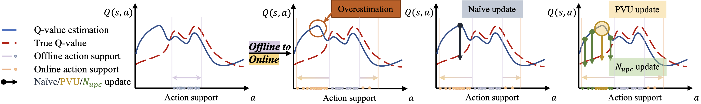
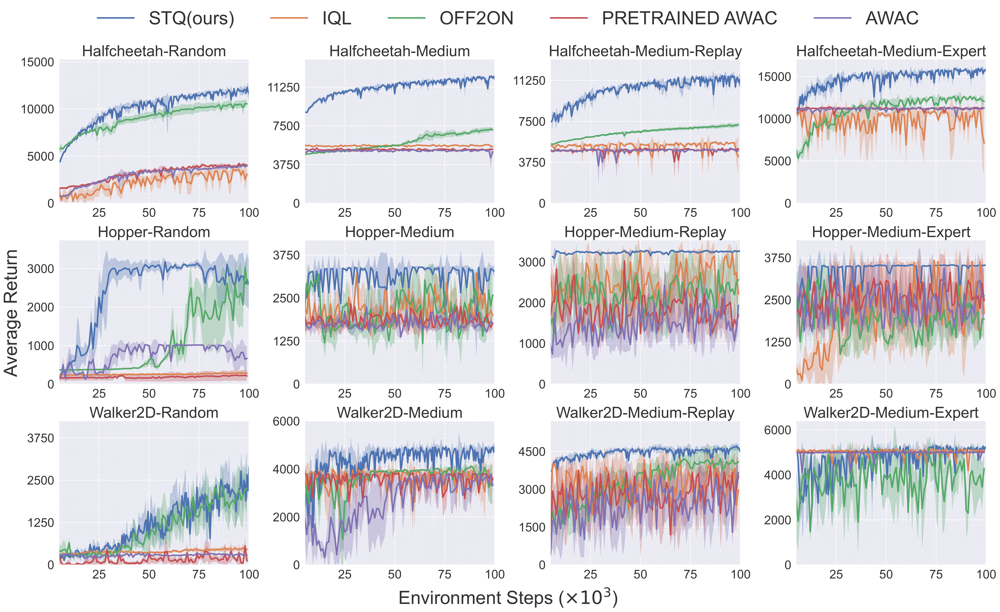

# 个人SO2 fork：稳定复现入口

**2026-10-28：科研暂停。** main保存已审阅的可复用代码，不自动运行任何旧任务。新的研究、训练、诊断、恢复或监控仍需用户明确授权；本次仅做仓库维护，没有模型/环境/optimizer执行。

| 想找什么 | 当前入口 | 证据/使用范围 |
|---|---|---|
| 研究讲述、完整成果与恢复 | [科研main](https://github.com/Ironkid-lzy/rl_sample_efficiency_research)、[恢复指南](https://github.com/Ironkid-lzy/rl_sample_efficiency_research/blob/main/docs/RESEARCH_RESUME.md) | 组会稿→全面报告→代码/分支/服务器资产 |
| 原版10Q正式基线 | tag `so2-baseline-exp015`，代码`048a5573a27115b3486e1dee7dde5bc6388850bb` | 固定作者parent、五online seed；不还原未知作者预训练 |
| 同结构EDAC→SO2与组件/min-mean对照 | `scripts/repro/t010_*`、`t011_*`、`t012_*` | 已验收实现；默认配置与历史身份不改 |
| 已知A1 matched-mask | `scripts/repro/t014_a1_mask.py`及A1 runner | main保留opt-in context；未显式安装时原Dropout路径，默认mode为independent |
| η0强基线/完整成本取舍 | `scripts/repro/t018_edac.py`、`t019_*`，稳定源`d25fcb93c686fb584407edf061b5b58109a83363` | 默认η1直接委托原loss；η0只由task-local显式启用。不是整体胜出或新算法 |
| 潜在候选A | branch `codex/so2-t020-actor-relative-advantage`，固定`dc6a54fa903e676d43f0c72ce19e81dcb98207ac` | 未入main；仅正确性/有限校准通过，比较控制未过门槛，正式方向和shadow未运行，无收益/创新结论 |
| 已结束的负控制/诊断/旧迁移 | `archive/2026-10-28/so2-tNNN-*` tags | 负结果与失败历史仍可精确恢复；分类/完整SHA看科研恢复表 |

本轮main从`5a826f88fba159f7a7c4c14be9b53d86bbadbb71`普通快进到既有T019链，再只附本README；没有重构算法、修改超参、seed、数据、评价或默认学习规则。旧run仍使用自己的source SHA和manifest，不能拿新的main SHA替换运行身份。历史runner会校验冻结HEAD、输入、预算和permit；不要复用旧permit/dispatch重发已终态attempt。

找回旧代码时，在已有clone读取精确tag或commit。示例：`git fetch origin tag archive/2026-10-28/so2-t019-eta0-multiseed`，随后只读`git show <tag>:<path>`；真正新运行需要新授权与协议。官方来源upstream只追溯、不推送；个人origin是唯一维护发布目标。

以下保留官方/早期安装说明，不能视作当前自动训练指令。环境始终位于项目自身`.venv`，大型数据/checkpoint不在此Git仓库；具体身份与备份缺口见科研恢复指南。

---

# SO2: A Perspective of Q-value Estimation on Offline-to-Online Reinforcement Learning

> **本 fork 已验收的基线：** [EXP-015 版本、结果与运行说明](BASELINE.md)。正式入口为 `scripts/repro/t003_run.py`，精确训练版本见 tag `so2-baseline-exp015`。以下保留上游说明，环境重建请优先使用基线文档中的已验证版本。

**SO2 offers a fresh perspective on offline-to-online reinforcement learning through Q-value estimation and presents a straightforward yet effective implementation.**



> [**SO2: A Perspective of Q-value Estimation on Offline-to-Online Reinforcement Learning**](https://arxiv.org/abs/2312.07685)               
> Yinmin Zhang, Jie Liu, Chuming Li, Yazhe Niu, Yaodong Yang, Yu Liu, Wanli Ouyang
> *[arXiv:2312.07685](https://arxiv.org/abs/2312.07685)* 

## Updates

- (12/2024) Code has been released!

## Installation

### All scripts

The scripts from installation to execution are all here👏.

Checkpoints can be downloaded from the following links: [Google Drive](https://drive.google.com/file/d/1ShHXQw2ox3F-9WKLOZo8Qnjn0mEtaQdl/view?usp=drive_link)

```
# install MuJoCo for Linux
mkdir -p ~/.mujoco/mujoco210 
wget https://mujoco.org/download/mujoco210-macos-x86_64.tar.gz -O mujoco210-macos-x86_64.tar.gz
tar -xf mujoco210-linux-x86_64.tar.gz -C ~/.mujoco/mujoco210 
pip install -U 'mujoco-py<2.2,>=2.1'

# install D4RL
pip install git+https://github.com/Farama-Foundation/d4rl@master#egg=d4rl

# install SO2
conda create --name SO2 python=3.7 -y
conda activate SO2
git clone -b code https://github.com/opendilab/SO2.git
pip install -e SO2

# run d4rl experiment
# Note download checkpoints and unzip into ckpt folder
python3 -u train.py 
```

### Install environment

#### Install MuJoCo and `mujoco-py`

1. Download the MuJoCo version 2.1 binaries for
   [Linux](https://mujoco.org/download/mujoco210-linux-x86_64.tar.gz) or
   [OSX](https://mujoco.org/download/mujoco210-macos-x86_64.tar.gz).
1. Extract the downloaded `mujoco210` directory into `~/.mujoco/mujoco210`.

To include `mujoco-py` in your own package, add it to your requirements like so:

```
pip install -U 'mujoco-py<2.2,>=2.1'
```

#### Install D4RL

D4RL can be installed by cloning the repository as follows:
```
git clone https://github.com/Farama-Foundation/d4rl.git
cd d4rl
pip install -e .
```

Or, alternatively:
```
pip install git+https://github.com/Farama-Foundation/d4rl@master#egg=d4rl
```

#### Install SO2

```
git clone https://github.com/opendilab/SO2@code
pip install -e SO2
```

## Getting Started

### MuJoco

```
python3 -u so2/d4rl_main.py
```

## Results
### MuJoCo


## License

This project is released under the Apache 2.0 license. See [LICENSE](LICENSE) for details.

## Citing SO2
If you use SO2 in your research or wish to refer to the baseline results published here, please use the following BibTeX entry.

```BibTeX
@inproceedings{zhang2023perspective,
  title={A Perspective of Q-value Estimation on Offline-to-Online Reinforcement Learning},
  author={Zhang, Yinmin and Liu, Jie and Li, Chuming and Niu, Yazhe and Yang, Yaodong and Liu, Yu and Ouyang, Wanli},
  booktitle={Proceedings of the AAAI Conference on Artificial Intelligence},
  year={2024}
}
```
